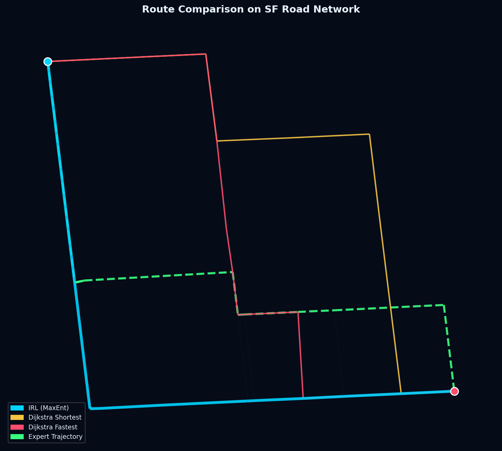
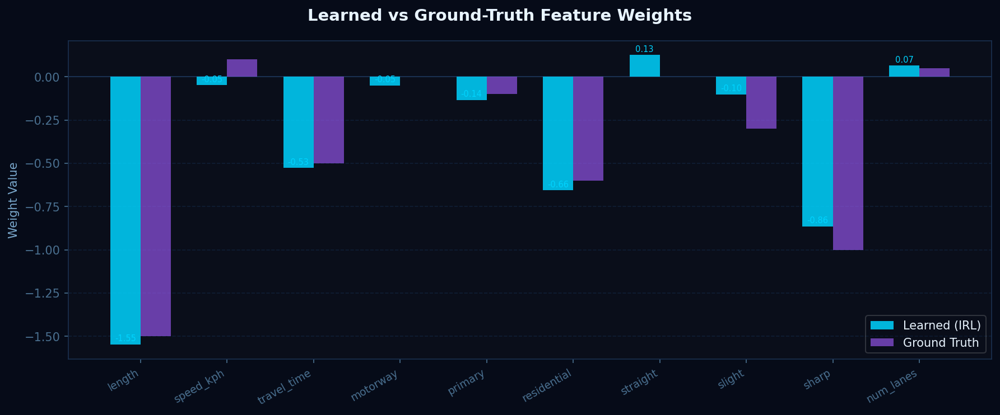
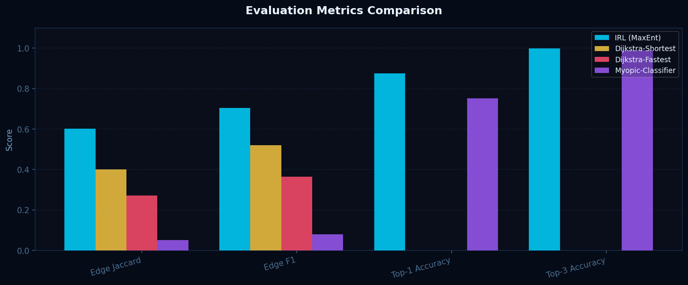

<h1 align="center">Route Preference Learning</h1>

<p align="center">
  <em>Nobody drives the shortest route. This project learns why.</em>
</p>

<p align="center">
  22AIE401 Reinforcement Learning &nbsp;·&nbsp; Amrita Vishwa Vidyapeetham, Amritapuri
</p>

<p align="center">
  
</p>

---

## The idea

Ask a navigation app for directions and you get the shortest or the fastest road. Real drivers often ignore both. They avoid awkward turns, skip tiny side streets, stay on roads they trust. None of that is written on the map, and drivers can't easily tell you their rules.

So we work backwards. We watch how drivers actually choose roads, and ask which hidden likes and dislikes would make those choices sensible. This is **inverse reinforcement learning**. We use its maximum-entropy form (Ziebart et al., 2008) with a deliberately simple reward: a weighted sum of ten road features. Because the model is that simple, you can read the weights directly and see what drivers care about.

The learned weights then plan new routes the way those drivers would.

## What we found so far

All numbers below come from simulated drivers on San Francisco's road network, with 60 held-out trips. Simulated drivers have known preferences, so we can check that the method recovers them. It does.

| Method | Overlap with driver's route (F1) | Edge Jaccard |
|---|:---:|:---:|
| **Learned from drivers (MaxEnt IRL)** | **0.704** | **0.602** |
| Shortest distance | 0.521 | 0.401 |
| Fastest time | 0.364 | 0.272 |
| One-turn-at-a-time classifier | 0.079 | 0.051 |
| *Oracle (told the true preferences)* | *0.703* | *0.601* |

The learned model matches the oracle, which is the ceiling. The recovered weights point almost exactly the same direction as the true ones (cosine similarity 0.987).

<p align="center">
  
  
</p>

> **Honest limit.** This shows the method works when drivers really do act like a linear-reward model. Whether real drivers do is the next question, and it needs real GPS data (see [Where this is going](#where-this-is-going)).

## Try it

```bash
pip install -r requirements.txt

python run_pipeline.py     # download the map, simulate drivers, train, evaluate
python run_api.py          # start the server on localhost:5000
```

Then open `dashboard/index.html` in a browser. It walks through the idea one step at a time, with a live map showing each method's route next to the real driver's.

The first run downloads San Francisco's road network from OpenStreetMap (about 30 seconds) and caches it.

## How it works

```
 driver trips  ──►  road-by-road sequences  ──►  find the reward that
 (GPS or            on the OSM map               explains the choices
  simulated)                                          │
                                                      ▼
  compare with  ◄──  plan new routes  ◄──  soft policy: at each junction,
  real drivers       for unseen trips       pick the next road by its reward
```

<details>
<summary><b>The model in detail</b></summary>

<br>

Route choice is a sequence of decisions, one at each junction, so we model it as a Markov decision process.

| Part | Definition |
|---|---|
| State | the current intersection **and** the road you arrived on, which makes turn angles well defined |
| Action | which outgoing road to take |
| Reward | `R = wᵀφ`, linear in ten road features |
| Policy | `π(a∣s) ∝ exp(Q_soft(s,a))`, the maximum-entropy choice rule |
| Training | maximise the likelihood of the observed trips, with exact gradients and L-BFGS |

The ten features: segment length, speed limit, travel time, three road classes (motorway, primary, residential), three turn types (straight, slight, sharp or U-turn), and number of lanes.

</details>

<details>
<summary><b>How we judge it</b></summary>

<br>

| Metric | Meaning |
|---|---|
| Edge Jaccard, Edge F1 | how many of the driver's roads the model's route shares |
| Path length ratio | model route length divided by the driver's (1.0 is ideal) |
| Top-1 / Top-3 accuracy | at each junction, is the driver's road the model's first or one of its top three choices |
| Held-out log-likelihood | how probable the model finds unseen trips |
